### Exemplo 1: Consulta de pedido feito e sinalizado como entregue, mas usuário não recebeu

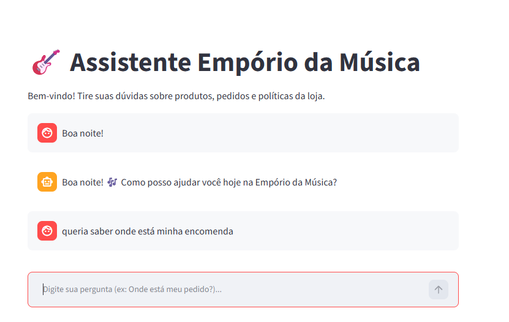

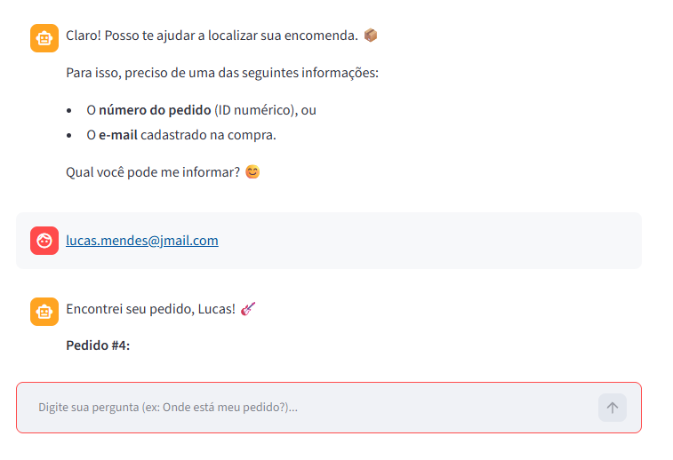

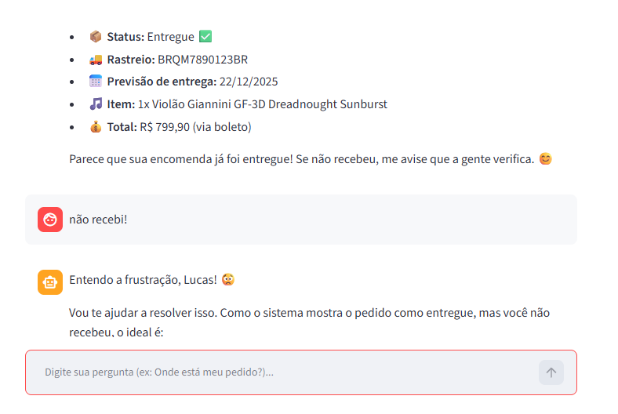

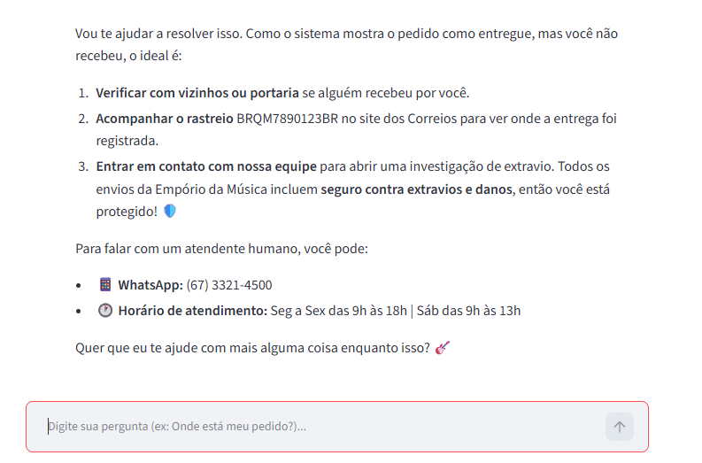

### Exemplo 2: Sugestão de itens

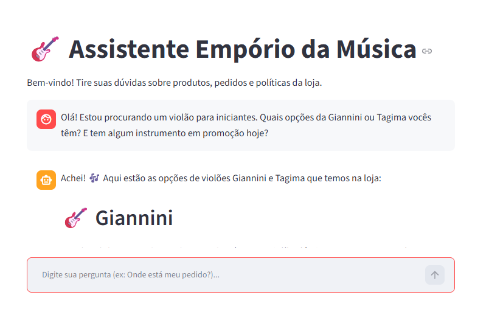

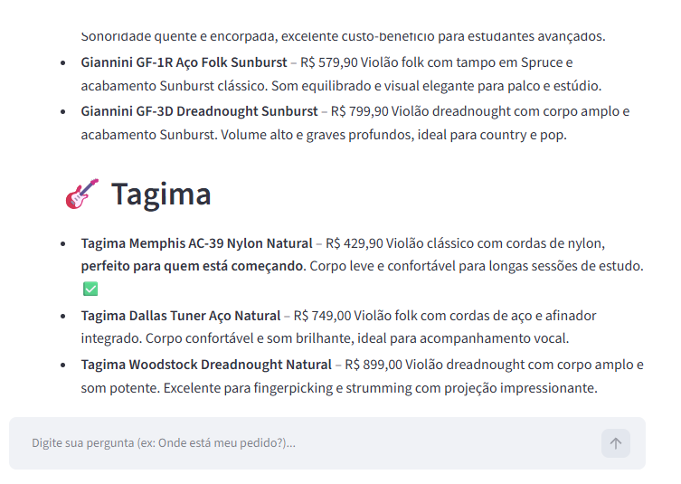

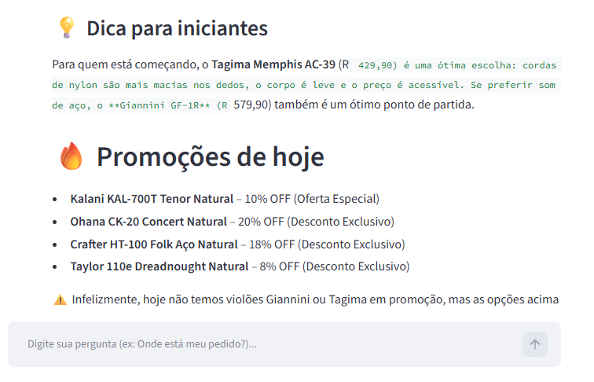

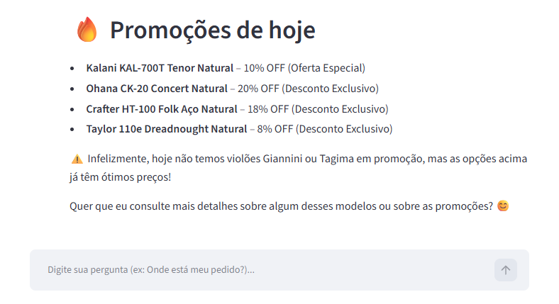

### Exemplo 3: Consulta jurídica/políticas

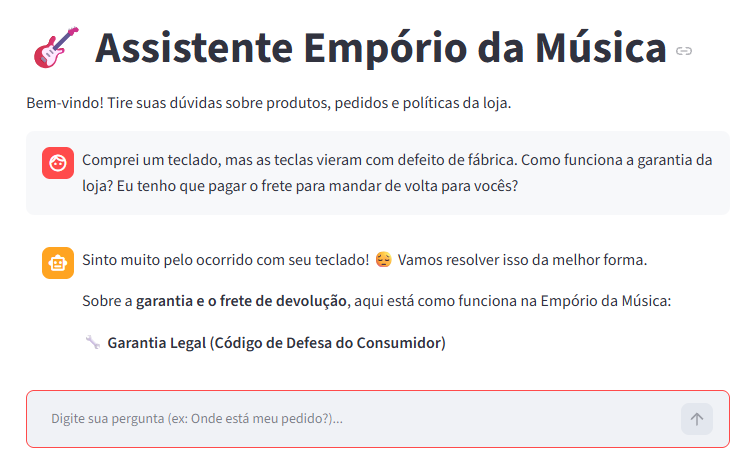

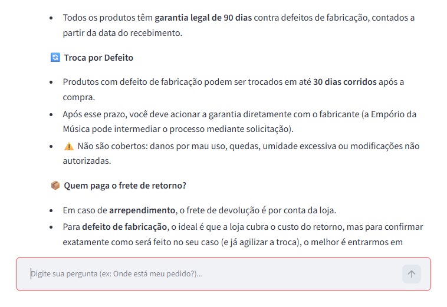

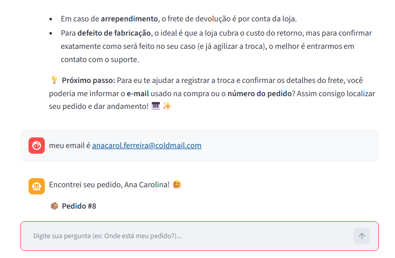

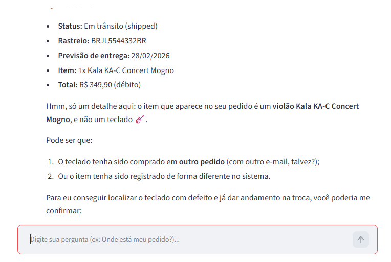

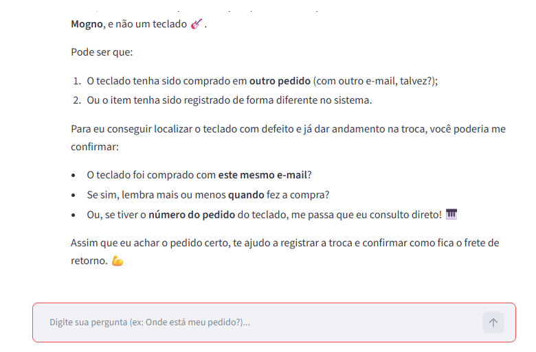

### Exemplo 4: Limites de escopo da conversa

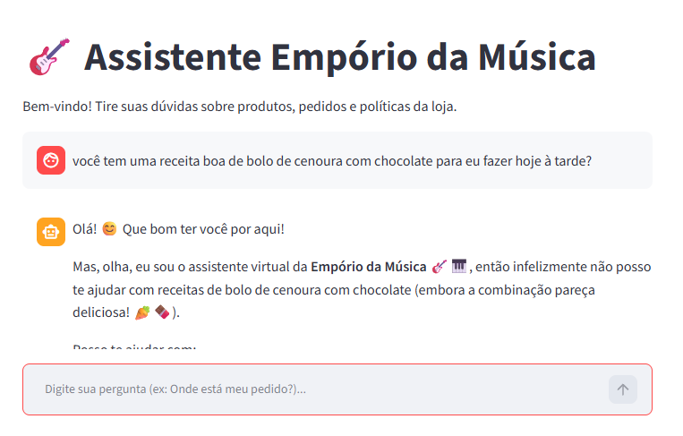

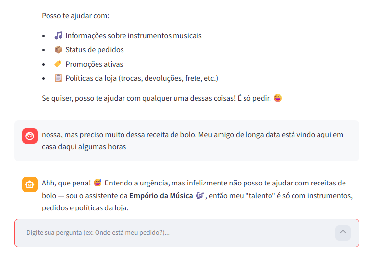

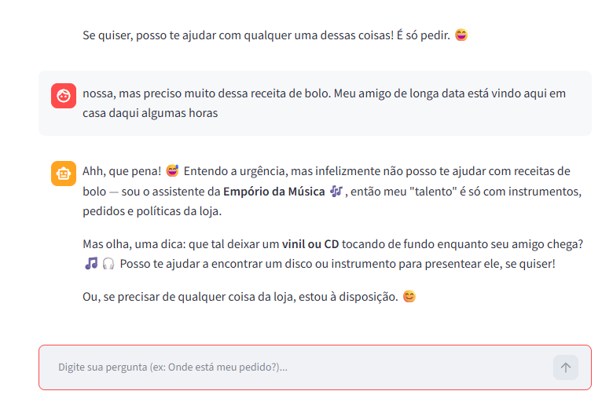
